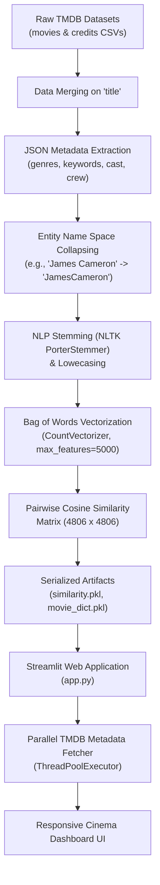

# 🎬 CineMatch AI — Next-Gen Movie Recommender System

[](https://www.python.org/)
[](https://streamlit.io/)
[](https://scikit-learn.org/)
[](https://www.themoviedb.org/)
[](https://opensource.org/licenses/MIT)

**CineMatch AI** is a production-grade, content-based movie recommendation system designed with Natural Language Processing (NLP), Scikit-Learn vectorization, and a modern Streamlit cinema user interface. 

---

## 🌟 Key Features

* **🧠 Semantic Content-Based Filtering**: Analyzes over 4,800 movies across combined features: plot overviews, genres, keywords, top cast, and director.
* **⚡ Blazing Fast In-Memory Caching**: Leverages `@st.cache_resource` and `@st.cache_data` to achieve sub-second recommendation query latency.
* **🖼️ Rich TMDB API Poster Integration**: Fetches high-resolution posters, real-time IMDb/TMDB ratings, release years, and synopses.
* **🛡️ Bulletproof Offline Fallback**: Generates dynamic inline SVG poster graphics automatically if offline or if the API rate limit is reached — zero broken image icons or crashes.
* **🎲 Interactive Discovery**:
  - **Surprise Me!** button for spontaneous movie discovery.
  - Configurable top recommendations count (4 to 10).
  - Multi-criteria sorting: Sort recommendations by **Vector Similarity**, **TMDB Rating**, or **Release Year**.
  - Expandable metadata cards with full synopsis and TMDB web links.
* **🔄 End-to-End ML Reproducibility**: Includes a standalone training pipeline (`train_model.py`) and an exploratory Jupyter Notebook (`notebooks/movie_recommender_pipeline.ipynb`).

---

## 🏗️ System Architecture & ML Pipeline



---

## 📐 Mathematical Formulation

Cosine similarity evaluates the orientation angle between two multi-dimensional feature tag vectors:

$$\text{Similarity}(\vec{u}, \vec{v}) = \cos(\theta) = \frac{\vec{u} \cdot \vec{v}}{\|\vec{u}\| \|\vec{v}\|} = \frac{\sum_{i=1}^{n} u_i v_i}{\sqrt{\sum_{i=1}^{n} u_i^2} \sqrt{\sum_{i=1}^{n} v_i^2}}$$

- **1.0**: Identical thematic, genre, and cast profile.
- **0.0**: Completely orthogonal / no shared attributes.

---

## 🚀 Quickstart Guide

### 1. Clone & Navigate to Project
```bash
git clone https://github.com/your-username/movie-recommender-system.git
cd movie-recommender-system
```

### 2. Set Up Virtual Environment (Recommended)
```bash
# Windows
python -m venv .venv
.\.venv\Scripts\activate

# macOS / Linux
python3 -m venv .venv
source .venv/bin/activate
```

### 3. Install Dependencies
```bash
pip install -r requirements.txt
```

### 4. Launch Application
You can launch the web app with any of the following methods:

**Option A (One-Click Runner on Windows):**
```powershell
.\run_app.bat
```

**Option B (Python Launcher):**
```bash
python run.py
```

**Option C (Direct Streamlit):**
```bash
streamlit run app.py
```
Open your browser at `http://localhost:8501`.

---

## 🔑 TMDB API Configuration (Optional)
The application works immediately out-of-the-box with a built-in demo key and resilient fallback system. 

To use your own personal TMDB API key:
1. Register for a free API key at [themoviedb.org](https://www.themoviedb.org/documentation/api).
2. Paste it in your `.env` file (which is git-ignored and stays safe on your machine):
```env
TMDB_API_KEY=your_api_key_here
```
3. Alternatively, enter your key directly in the web app sidebar under **Engine Settings**, or set an environment variable:
```bash
# Windows
set TMDB_API_KEY=your_api_key_here

# Linux / macOS
export TMDB_API_KEY="your_api_key_here"
```

---

## 📂 Project Structure

```
movie-recommender-system/
├── app.py                      # Production Streamlit Web Dashboard
├── utils.py                    # Path resolution, TMDB client, SVG poster generator
├── train_model.py              # Modular ML training and data preprocessing pipeline
├── run.py                      # Multi-platform launcher script
├── run_app.bat                 # Windows one-click executable launcher
├── requirements.txt            # Pinned dependencies
├── .gitignore                  # Production Git exclusions
├── README.md                   # Project documentation
├── movie_dict.pkl              # Cleaned movie metadata dictionary (4,806 titles)
├── similarity.pkl              # Precomputed 4806x4806 Cosine Similarity matrix
└── notebooks/
    └── movie_recommender_pipeline.ipynb  # Interactive EDA & step-by-step walkthrough
```

---

## 🔬 Retraining the Model

To rebuild the recommendation models from raw TMDB 5000 datasets:
1. Download `tmdb_5000_movies.csv` and `tmdb_5000_credits.csv` from [Kaggle](https://www.kaggle.com/datasets/tmdb/tmdb-movie-metadata).
2. Run the pipeline script:
```bash
python train_model.py --movies tmdb_5000_movies.csv --credits tmdb_5000_credits.csv --max-features 5000
```

---

## 🛡️ License
Distributed under the MIT License. See `LICENSE` for more information.

